# 校园智能调度平台（前后端演示版）

> 一句话描述校园需求 → AI 解析意图 → 匹配校园资源 → 生成可执行结果 → 自动通知相关人。
> 河南新华电脑学院 · AI 应用创意大赛 · V1.0

本项目是《校园智能调度平台项目方案》的**可运行全栈实现**。
账号、会话、角色权限、业务共享数据、系统配置和 DeepSeek 接入由 Node.js + SQLite 提供。四个校园场景的数据可在多用户之间云端共享，并通过高级管理员配置的 API Key 调用真实 DeepSeek-V4.1-Flash。

---

## 一分钟启动

```bash
cd campus-smart-dispatch-platform
npm install
npm run dev
```

浏览器打开 http://localhost:5173 即可。`npm run dev` 会同时启动 Vue 前端和 Node.js/SQLite 后端，Vite 自动把 `/api` 代理到 `3001` 端口。

登录页提供“评审快速入口”，可一键切换五种内置角色；进入系统后点击顶栏“评审向导”，可按失物认领、拼单跑腿、角色权限三条线路完成约 3 分钟演示。

### 依赖自动管理

启动、构建和生产运行前都会自动执行依赖检查：

- 缺少依赖包时自动运行 `npm install`
- 已安装版本不满足 `package.json` 版本范围时自动运行 `npm update`
- 安装或更新后再次执行 `npm ls` 校验，未通过则阻止应用启动并显示原因
- 手动检查可运行 `npm run deps:check`

日志统一使用 `[deps][INFO]`、`[deps][WARN]`、`[deps][OK]` 和 `[deps][ERROR]` 前缀。网络、registry、代理或目录权限异常时会输出明确的排查提示。

Node.js 运行时由 `scripts/bootstrap-node.ps1` 独立准备，不需要系统预装 Node：

- 优先复用项目内 `runtime/node.exe`
- 缺失、损坏或低于 Node.js 24 时自动下载官方 Windows ZIP
- 下载后校验 SHA-256，再解压到 `runtime`
- 自动验证 `node.exe`、`node:sqlite` 和 `npm.cmd`
- 失败时保留原运行环境并显示网络、代理、防火墙或目录权限提示

> Windows 下可以直接**双击项目根目录的 `启动校园智能调度平台.bat`**：会检查 Node.js 24、`node:sqlite` 和依赖，随后同时启动前后端并自动打开浏览器；停止服务用 `停止校园智能调度平台.bat`（只会结束本项目 5173 与 3001 端口上的进程）。
> 注意：`index.html` 是 Vite 的源码入口，**不能双击用 `file://` 打开**，必须通过开发服务器访问；`dist/index.html` 同理，需要静态服务器。原因见文末「已知边界」。

生产构建与一体化运行：

```bash
npm run build
npm start           # Node 同时提供 dist 与 /api，默认 http://localhost:3001
```

Docker 运行：

```bash
docker compose up --build
```

数据卷 `campus-smart-dispatch-platform-data` 持久化 SQLite、上传图片和加密密钥。

> 如果构建时遇到 esbuild 临时目录权限报错（部分受限环境），改用 `./scripts-build.sh`：
> 它会把 `TMP/TEMP/TMPDIR` 指向项目内 `.tmp/` 后再执行 `npm run build`。

技术栈：**Vue 3 + Vite + Pinia + Vue Router + Element Plus + Node.js + SQLite + DeepSeek API**。后端业务与云同步使用 Node.js 内置模块，无额外 npm 依赖。

完整接口、角色等级、数据库表结构与安全边界见 [docs/backend.md](docs/backend.md)；五类角色能力与数据范围见 [docs/role-permissions.md](docs/role-permissions.md)。
寻物悬赏与拼单跑腿的状态流、取消边界和结算规则见 [docs/lostfound-reward-and-errand.md](docs/lostfound-reward-and-errand.md)。
同步冲突、增量同步、图片上传、安全与数据库维护策略见 [docs/reliability-and-security.md](docs/reliability-and-security.md)。

---

## 部署上线（拿到固定网址）

项目当前是 Node.js 24 + SQLite 全栈应用，不能再把 `dist/` 当作完整可登录网站部署。完整功能必须运行 Node 24 服务，由它同时提供 `/api`、图片上传和 `dist/`，或将 `VITE_API_BASE_URL` 指向独立 API 域名。

| 方式 | 适合 | 操作 | 网址 |
| --- | --- | --- | --- |
| Node 一体化 | 完整功能、演示和正式部署 | `npm ci && npm run build && npm start`，持久化 SQLite 与上传目录 | 自有域名或服务器 IP |
| 学校服务器 | 国内访问快，推荐 | Node 24 服务 + Nginx 反向代理，同时代理 `/api` 与前端 | 自有域名 |
| Netlify / Vercel | 仅前端 CDN | 必须配置独立 `VITE_API_BASE_URL`；平台不能运行当前 SQLite 写服务 | CDN 域名 |
| 纯静态预览 | 只看界面 | 可以打开页面；本仓库的 GitHub Pages 版本另带浏览器内演示 API（`VITE_DEMO_API=1`），账号、权限、通知与共享数据可用，AI 走本地规则引擎 | 仅用于展示，正式验收请用 Node 一体化部署 |

```bash
npm run build        # 产物在 dist/；受限环境用 ./scripts-build.sh
```

> ⚠️ Node 版本必须为 24+；图片存储在 `server/data/uploads/`，SQLite、上传目录和可选 `.secrets-key` 都需要持久化与备份。Netlify/Vercel 配置已明确禁止把 `/api/*` 回退成 HTML。完整说明见 [docs/deployment.md](docs/deployment.md)。

### 在线演示（GitHub Pages）

- 地址：<https://mzm995.github.io/campus-smart-dispatch-platform/>
- 仓库：<https://github.com/mzm995/campus-smart-dispatch-platform>
- 说明：Pages 只能跑静态文件，因此构建时注入 `src/utils/demoApi.js`（浏览器内 `fetch` 拦截层，用 localStorage 复刻 `server/index.js` 的接口契约）。演示账号、角色权限、通知、四场景共享数据与系统设置照常工作；AI 接口返回 `AI_KEY_NOT_CONFIGURED`，前端自动切到本地规则引擎。真实的多用户云端同步与 DeepSeek 调用仍需 Node 一体化部署。

重新发布：

```bash
VITE_DEMO_API=1 VITE_PAGES_REPO=campus-smart-dispatch-platform npx vite build
node scripts/postbuild-pages.mjs        # 生成 404.html（深链接回退）与 .nojekyll
# 把 dist/ 内容推到 gh-pages 分支即可
```

---

## 讲解 PPT（参赛路演）

PPT 位于 [`docs/校园智能调度平台-项目讲解.pptx`](docs/校园智能调度平台-项目讲解.pptx)，16:9、共 14 页，按「问题 → 产品 → AI → 工程与边界」组织：

1. 封面　2. 问题与机会　3. 方案总览　4. 一句话交互　5. 教室借用
6. 失物招领　7. 拼单集市　8. 从社团排班到校园论坛　9. AI 能力层
10. 两轮迭代　11. 设计系统　12. 工程质量　13. 边界与路线　14. 收尾

> 页面中的准确率、响应时间等均为**演示内置模拟数据**（AI 使用记录页同源），不是线上实测；PPT 内已加脚注说明。
> 重新生成：`python scripts/build-ppt.py`（依赖 python-pptx；截图取自 `docs/ppt-assets/`，可用 `scripts/shot.mjs` 重拍）。

另有一份面向完整答辩讲解的 **18 页完整版** [`docs/校园智能调度平台-项目讲解-完整版.pptx`](docs/校园智能调度平台-项目讲解-完整版.pptx)，每页均含 90–115 字演讲备注，内容涵盖 42 处场所构成、四个场景、AI 五个核心函数、两轮迭代、设计系统、工程验证、演示身份、3 分钟演示脚本与故障预案；重新生成用 `python scripts/build-ppt-full.py`。

另有面向大赛「创意说明」的 **5 分钟版** [`docs/校园智能调度平台-创意说明-5分钟.pptx`](docs/校园智能调度平台-创意说明-5分钟.pptx)，10 页、每页标注起止时间与秒数，备注合计约 1150 字（可直接作为 800–1200 字创意说明底稿）；重新生成用 `python scripts/build-ppt-brief.py`。

---

## 演示账号

登录页左侧填写姓名和自设密码即可创建新人物，学号由系统自动分配；所有内置账号和自建人物固定显示在右侧。点击账号后输入密码才能进入：

| 身份 | 学号 | 姓名 | 密码 | 可体验 |
| --- | --- | --- | --- | --- |
| 学生 | 2024010123 | 林小满 | `123456` | 全部场景的发起与参与 |
| 班委 | 2023020456 | 陈子昂 | `123456` | 教室申请与审核视角 |
| 论坛坛主 | 2022050789 | 苏念 | `123456` | 论坛全部权限，可删除任意帖子 |
| 管理员 | 2021000001 | 周老师 | `123456` | 内容管理、教室申请审核 |
| 高级管理员 | 2021000000 | 方主管 | `123456` | 查看管理页、调整其他账号权限与状态 |

姓名最多 10 个字，当前有效账号姓名不可重复；自设密码为 8–32 个字符，并拒绝常见弱口令。自动学号默认从 `21040001` 开始递增；高级管理员删除自建人物后，该学号进入继承池，优先分配给下一名新人物。人物记录采用软删除，原始学号、角色、删除人与时间都会保留。密码使用随机盐 `scrypt` 哈希保存，不存明文。配置 `REGISTRATION_CODE` 后，公开注册必须填写邀请码。

权限最高只能授予管理员。高级管理员账号受保护，不能通过管理页或 API 再创建、提升或降级为高级管理员。内置演示账号不可删除，删除按钮只出现在自建人物上。

---

## 界面预览

桌面端（1600 宽）：

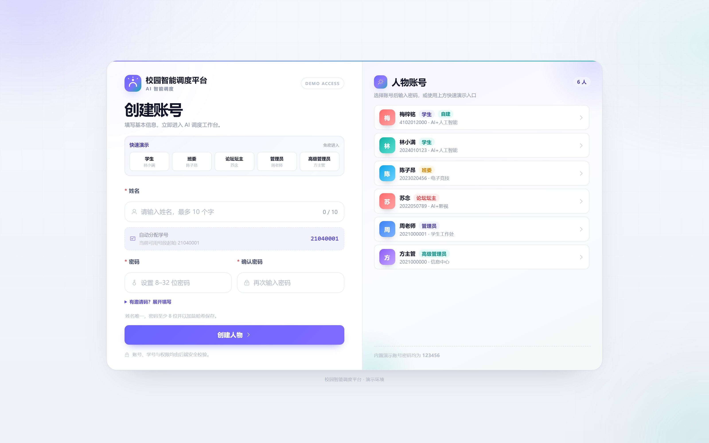

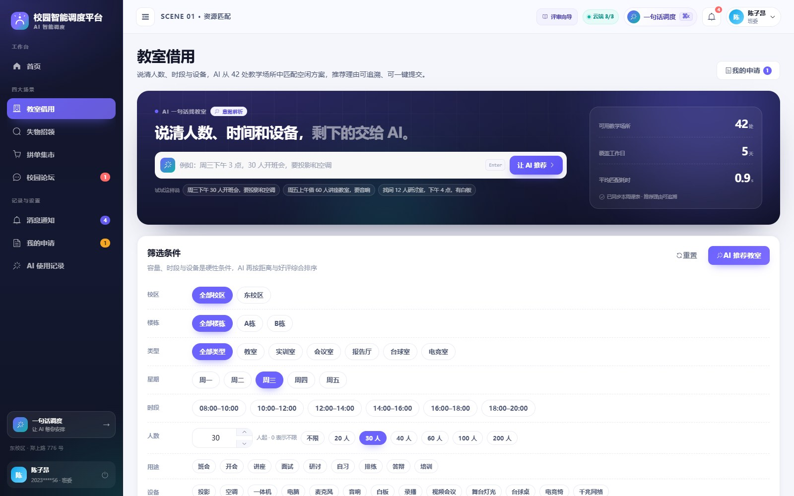
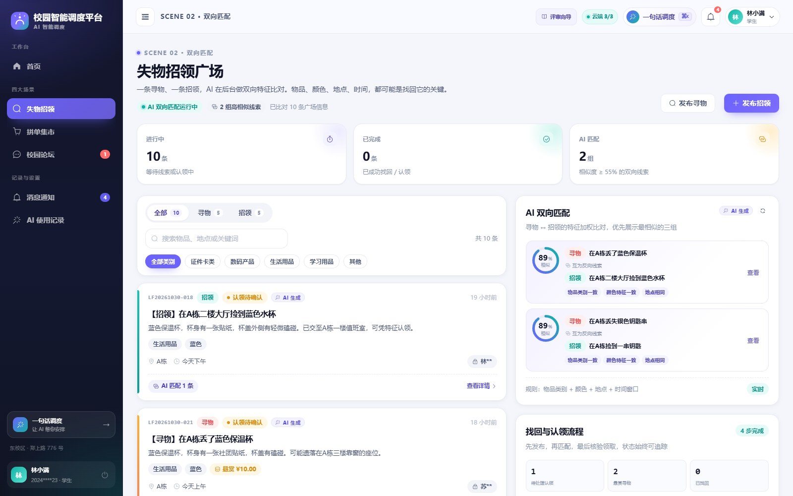
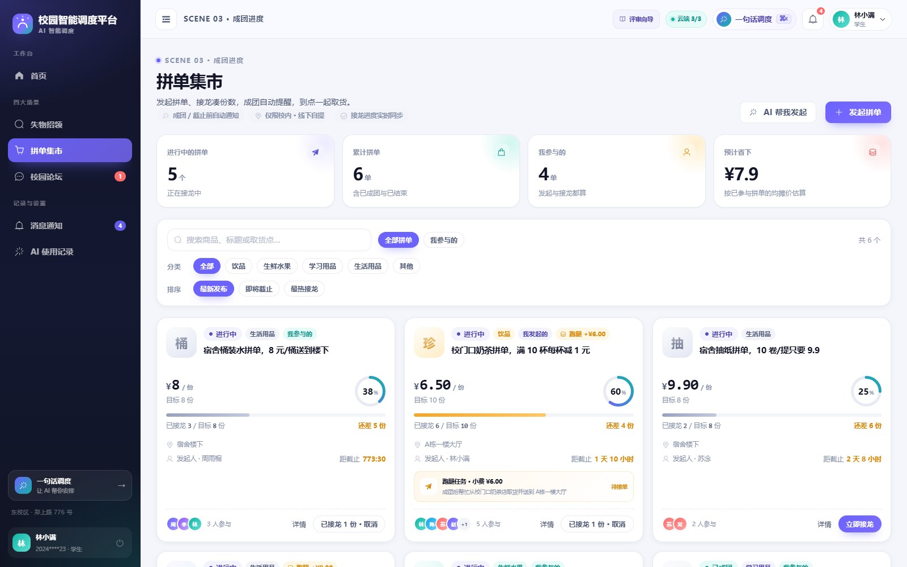
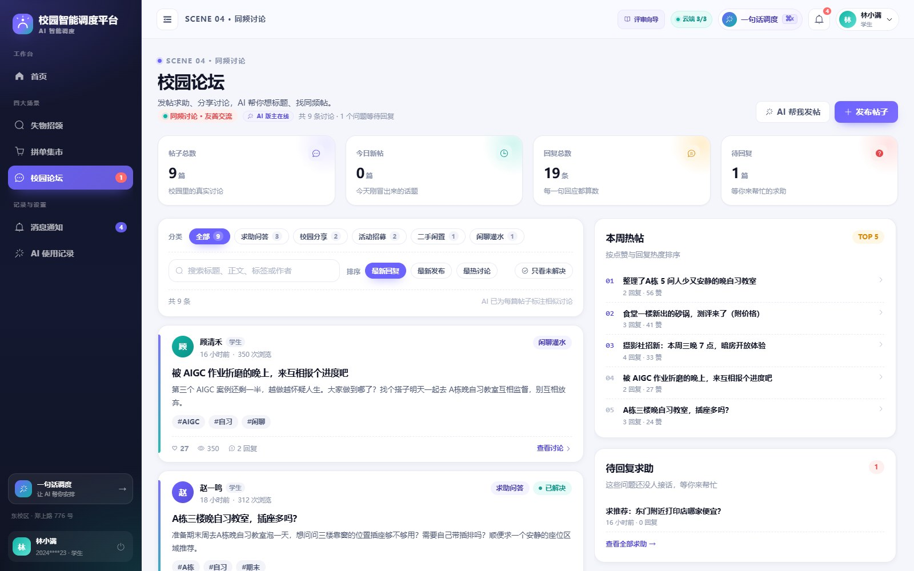
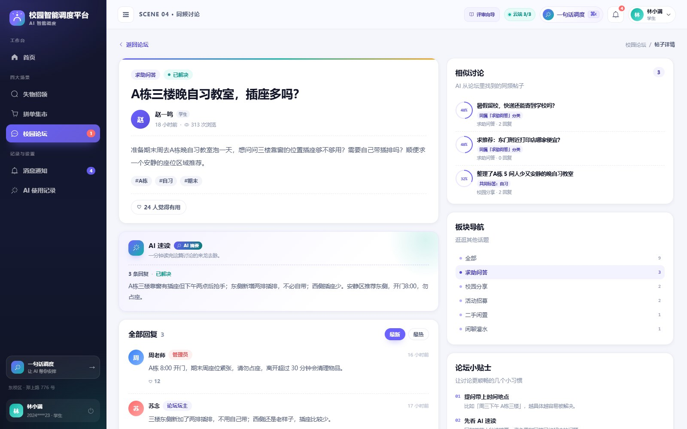
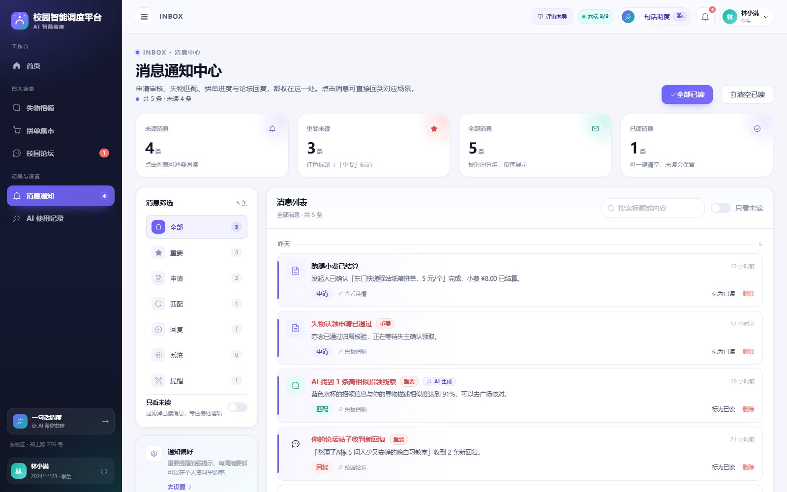
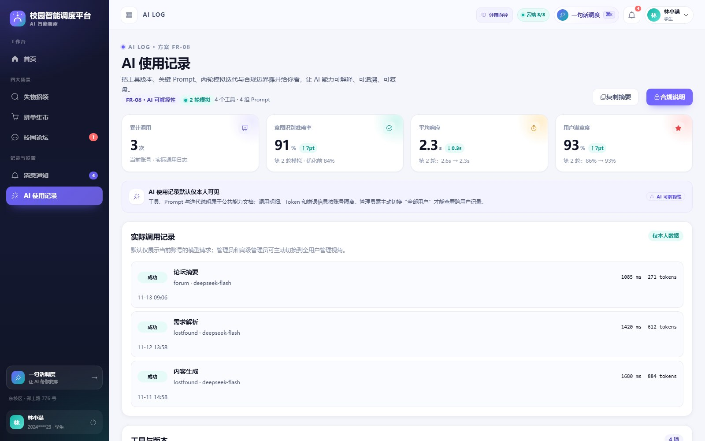
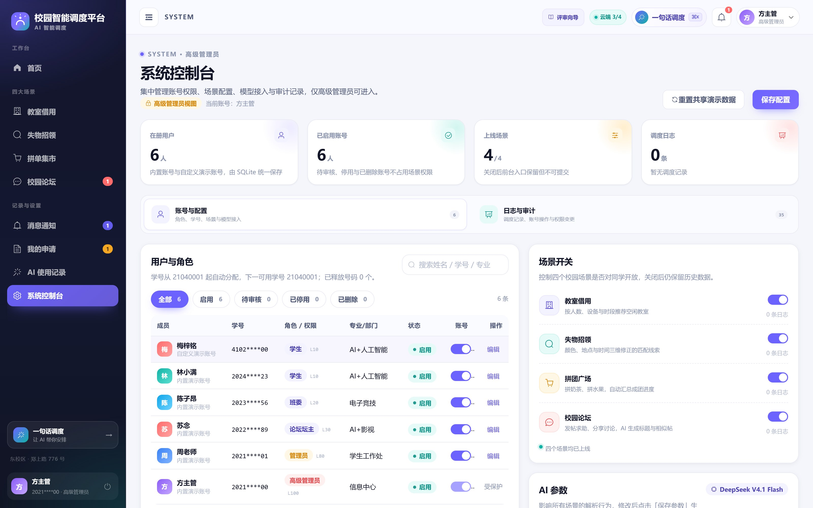

移动端（390 宽）：

<p>
  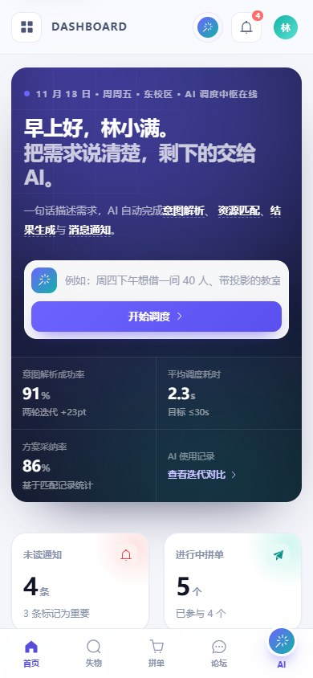
  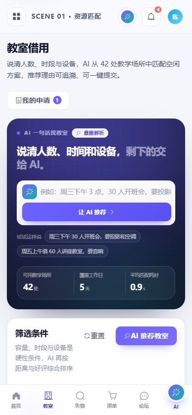
  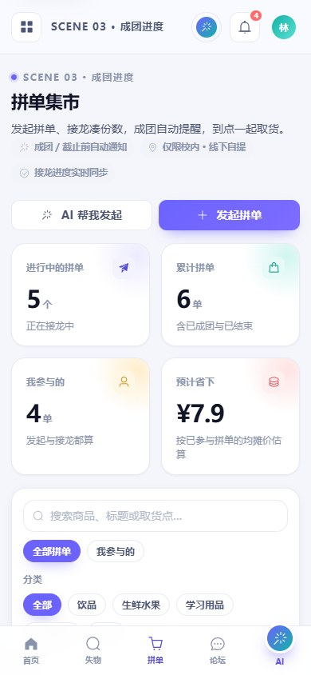
  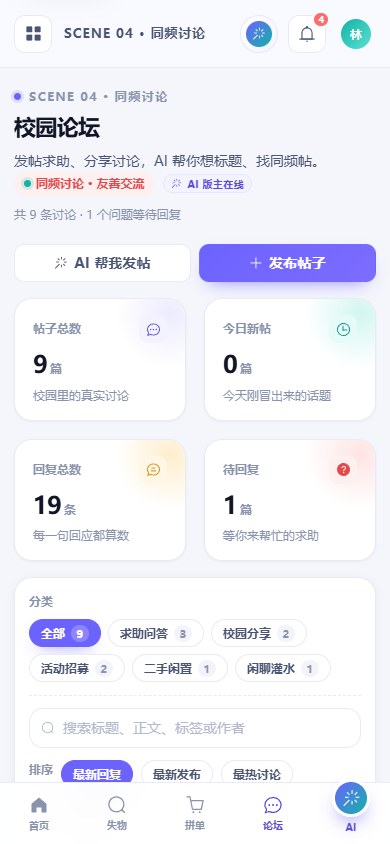
</p>

> 截图由 `scripts/shot.mjs` 在本机 Chrome 无头模式下生成，演示数据均为虚构。

---

## 功能地图

| 模块 | 路由 | 说明 |
| --- | --- | --- |
| 登录 | `/login` | 姓名 + 自设密码创建人物、系统自动分配学号、右侧固定展示全部人物、所有账号密码登录 |
| AI 调度工作台 | `/` | 全局一句话输入、AI 调度流水线、KPI、四大场景入口、待办、通知、拼单进度、AI 匹配线索、调度记录 |
| 教室借用 | `/classroom` | 42 处教学场所（A栋 36 间教室 + 会议室 + 报告厅；B栋 台球教室 + 3 间电竞教室）、类型/容量/时段/设备筛选、AI 推荐 2–3 处候选并说明理由、场所详情与空闲时段、一键申请、状态追踪 |
| 我的申请 | `/classroom/status` `/classroom/status/:id` | 申请列表、状态筛选、时间线、详情、撤销/再次申请 |
| 失物招领广场 | `/lostfound` | 寻物/招领双栏筛选、AI 双向匹配、寻物悬赏、线索提交、打赏确认、无打赏时自行联系领取 |
| 发布寻物/招领 | `/lostfound/publish` | 图片本地预览、AI 生成规范文案（可编辑）、实时预览、隐私脱敏、`?from=ai` 预填 |
| 拼单集市 | `/groupbuy` | 列表、接龙、进度提醒，以及附带小费的跑腿任务发布、接单、送达、确认结算与取消 |
| 拼单详情 | `/groupbuy/:id` | 进度、成员明细、接龙、分享文案、AI 建议、状态流转 |
| 校园论坛 | `/forum` | 分类/排序/搜索、帖子列表、点赞与浏览、本周热帖、待回复求助、AI 起草与相似帖推荐 |
| 帖子详情 | `/forum/:id` | 正文与标签、AI 速读摘要、回复（最新/最热）、点赞、标记解决、相似讨论、板块导航 |
| 消息通知 | `/notifications` | 默认仅本人通知；管理员和高级管理员可切换到全部用户只读管理视角；支持筛选、已读与清空本人消息 |
| AI 使用记录 | `/ai-record` | 本人真实调用明细与统计、工具与版本、关键提示词、两轮迭代对比；管理员可选择跨用户管理视角 |
| 系统控制台 | `/system` | 仅高级管理员可见；账号角色、自动学号、场景与 AI 配置、调度记录和审计日志分组管理 |
| 个人资料 | `/profile` | 资料编辑、自定义头像、通知偏好、隐私设置、退出登录 |
| 404 | 任意未知路径 | 友好兜底与返回入口 |

### 方案 FR 对照

- **FR-01 全局一句话输入（P0）**：首页 Hero 输入条 + 顶栏「一句话调度」+ 移动端 AI 悬浮按钮 + `⌘K` 快捷键，任何页面都能唤起。
- **FR-02 AI 意图解析与确认（P0）**：解析结果以弹层呈现，展示识别场景、置信度、摘要与结构化字段，**全部字段可编辑**，确认后才执行；置信度偏低时给出「请人工确认」提示；无法识别时给出四个场景快捷入口。
- **FR-03 教室借用（P0）**：42 处教学场所（A栋 36 间教室、3F 会议室、1F 报告厅；B栋 1F 台球教室、2F 三间电竞教室），按类型/容量/时段/设备硬过滤，再按距离与好评排序，输出 2–3 处候选并逐条说明推荐理由、冲突提示、空闲时段；容量待核场地会提示管理员确认；一键申请后进入状态跟踪（待审核 → 已通过 → 已完成/已取消），支持管理员审核。
- **FR-04 失物招领（P0）**：图片上传（本地预览）、AI 生成标准标题/描述/标签、双向特征匹配（类别/颜色/地点/时间），展示相似度与匹配理由，支持标记找回。
- **FR-05 拼单集市（P1）**：创建（商品、单价、目标份数、截止时间、取货点）、实时进度、参团/取消、满员与截止自动提醒（消息中心 + 站内通知）。
- **FR-06 校园论坛（由原「社团排班」场景改造，P1）**：支持发帖（求助问答/校园分享/活动招募/二手闲置/闲聊灌水）、回复、点赞与标记解决，分类筛选、排序与搜索；发布时 AI 根据一句话生成规范标题、正文与标签，并在发布前推荐相似帖；详情页提供 AI 速读摘要，新回复自动进入消息中心。
- **FR-07 消息通知（P0）**：统一收件箱、重要消息红色/重要标记、顶部铃铛未读角标、逐条已读与批量操作、按类型筛选。
- **FR-08 AI 使用记录（P0）**：使用工具与版本、关键提示词、两轮迭代前后指标对比、调用趋势、合规与隐私说明。

### 非功能要求落地

- **加载与反馈**：路由懒加载；AI 解析 1.2–1.5s 模拟「思考 → 结果」过程；所有提交按钮有 loading，列表有骨架/空状态，异常有友好提示。
- **30 秒内返回**：本地解析与匹配均为毫秒级，界面以 1–1.5s 编排「AI 思考」节奏，远低于 30s 上限；超时与失败有降级提示（可改用手动表单）。
- **核心流程 ≤3 步**：一句话 → 确认解析 → 结果页一键提交。
- **隐私**：登录密码仅保存随机盐 `scrypt` 哈希；不采集真实手机号；登录页人物列表展示演示学号，其他页面仍按需脱敏；失物联系方式默认隐藏；所有 AI 生成内容均带「AI 生成」标识；演示数据全部为虚构。
- **响应式**：桌面优先，1180 / 900 / 640 三档断点；移动端提供底部标签栏、AI 悬浮入口、单列卡片、可横向滚动的筛选条与表格，核心操作可在手机上完成。

---

## AI 能力是怎么实现的

高级管理员在「系统控制台 → DeepSeek 模型接入」配置 API Key 后，需求解析、论坛草稿、失物文案和论坛摘要会优先通过后端调用真实 DeepSeek-V4.1-Flash，官方模型标识为 `deepseek-flash`。未配置密钥、网络异常、鉴权失败或限流时，系统会提示原因并自动使用本地规则引擎降级。

1. **需求解析**：DeepSeek 输出结构化场景、字段、缺失项和置信度，前端继续复用可编辑确认单；失败时由 `parseRequirement()` 本地规则兜底。
2. **智能匹配**：`recommendClassrooms()` 硬条件过滤 + 多维加权排序并生成理由；`scoreLostPair()` 对寻物/招领做双向特征打分；`scoreForumPost()` / `similarForumPosts()` 结合分类、标签与文本重合度为草稿推荐相似帖。
3. **结果生成**：DeepSeek 生成失物招领文案、论坛标题/正文/标签和讨论摘要；异常时使用原有本地模板。
4. **自动通知**：各 store 在关键节点（申请通过、拼单满员、匹配成功、论坛收到回复）调用通知中心，形成统一消息流。

API Key 使用 AES-256-GCM 加密后存入服务端 SQLite，浏览器只显示末 4 位。管理页提供真实连接测试和完整错误提示。

「AI 使用记录」页完整展示了工具与版本、关键提示词、两轮迭代的前后指标与改动说明，对应方案中「≥2 轮迭代」的量化要求。

---

## 目录结构

```
campus-smart-dispatch-platform/
├─ index.html                 # 启动骨架屏
├─ 启动校园智能调度平台.bat              # 一键启动（检查依赖 / 端口，自动打开浏览器）
├─ 停止校园智能调度平台.bat              # 安全停止本项目 5173 上的 Vite 进程
├─ 创建桌面快捷方式.bat         # 在桌面生成带图标的启动快捷方式
├─ vite.config.js             # @ 别名、端口、构建分包
├─ netlify.toml               # Netlify 构建 + SPA 回退 + 静态资源缓存
├─ vercel.json                # Vercel 构建 + SPA rewrites
├─ docs/                      # 截图、讲解 PPT、部署指南、前端实现契约
│  ├─ 校园智能调度平台-项目讲解.pptx      # 14 页参赛路演 PPT（含演讲备注）
│  ├─ 校园智能调度平台-项目讲解-完整版.pptx # 18 页完整答辩版（含逐页备注）
│  ├─ 校园智能调度平台-创意说明-5分钟.pptx  # 10 页 / 5 分钟创意说明版
│  └─ ppt-assets/             # PPT 使用的主视觉截图
├─ public/_redirects          # Netlify SPA 回退（拖拽部署也生效）
├─ scripts/shot.mjs           # 开发期截图脚本（CDP，无额外依赖）
├─ scripts/audit.mjs          # 全路由巡检脚本（控制台 / 溢出 / 占位）
├─ scripts/build-ppt.py       # 重新生成 14 页讲解 PPT（python-pptx）
├─ scripts/build-ppt-full.py  # 重新生成 18 页完整答辩版 PPT
├─ scripts/build-ppt-brief.py # 重新生成 10 页 / 5 分钟创意说明版
├─ scripts-build.sh           # 受限环境下的构建脚本（TMP 指向项目内）
└─ src/
   ├─ main.js                 # 应用入口，按顺序加载样式与 Element Plus
   ├─ App.vue                 # 根组件，接管启动骨架屏
   ├─ router/index.js         # 路由表 + 登录/管理员守卫
   ├─ layouts/AppLayout.vue   # 布局壳：侧边栏 + 顶栏 + 移动端底部标签栏 + 全局 AI 弹层
   ├─ styles/                 # tokens / base / element / utilities 设计系统
   ├─ components/             # 15 个可复用组件
   ├─ views/                  # 各页面（按场景分目录）
   ├─ stores/                 # Pinia：user / app / notify / dispatch / 四大场景 / aiRecord
   ├─ utils/                  # format / storage / aiEngine（AI 能力层）
   └─ mock/seed.js            # 虚构演示数据
```

### 共享组件

更完整的组件属性、Store 接口与查询参数约定见 [docs/engineering-contract.md](docs/engineering-contract.md)。

`AppLogo`、`PageHeader`、`SectionCard`、`StatTile`、`StatusPill`、`EmptyState`、`ProgressRing`、`CountdownText`、`AvatarStack`、`SceneIcon`、`SceneTile`、`AiBadge`、`AiThinking`、`AiParseDialog`、`AppSidebar`。布局壳 `layouts/AppLayout.vue` 负责组合侧边栏、顶栏、移动端标签栏与全局 AI 弹层。

### 设计系统

- 主色电光紫 `#6C63FF`，辅助青绿 `#12B3A6`、琥珀 `#F5A623`、珊瑚 `#FF6B6B`；
- 深色渐变 Hero + 浅色工作区（`#F5F6FB`），18px 卡片圆角、克制的阴影与描边；
- Element Plus 通过 CSS 变量整体换肤，与自定义组件风格统一；
- 字号、间距、圆角、阴影、动效全部沉淀为 CSS 变量（`src/styles/tokens.css`），页面复用 `utilities.css` 工具类，避免各页样式各写一套。

---

## 校园实际情况与数据来源

本项目按河南新华电脑学院东校区的公开信息与教学场所表做了本地化，避免出现与校区不符的场地和课程内容。

- 学校：河南新华电脑学院 · 东校区
- 地址：河南省郑州市中原区郑上路 776 号
- 电话：0371-66655579
- 交通：地铁 10 号线郑州西站 → 11 路三十里铺西方向，建设西路小李庄站
- 教学场所：按《10.26 教学场所（东校区）》整理为 A 栋 36 间教室 + 会议室（3F，30 座）+ 报告厅（1F，200 座），B 栋台球教室（1F，40 座）+ 3 间电竞教室（2F，48/40/32 座），共 42 处
- 公共地点：学生超市、宿舍、浴室、免费洗衣机、操场、篮球场等，作为失物招领、论坛话题与拼单取货点使用
- 拼单取货点使用 A栋一楼大厅、学生超市门口、食堂门口、宿舍楼下、快递驿站、东门打印店等公开地标；不虚构具体商户名称与门牌

> 说明：教学场所数量与房号来自用户提供的 Excel；B 栋特殊教室与场地占用为演示设定；学校地址、电话与交通信息来自学校官网「来校路线」，公共地点名称来自官网「校园风光」。来源：http://www.hnxhdn.com/tg/cclx/ 、 http://www.hnxhdn.com/xyfg/

---

## 数据与状态

- 所有演示数据来自 `src/mock/seed.js`，为虚构内容；教学场所按《10.26 教学场所（东校区）》重建：A栋 36 间教室 + 会议室（3F，30 座）+ 报告厅（1F，200 座）+ B栋 台球教室（1F，40 座）+ 3 间电竞教室（2F），共 42 处；桌椅数量为空的 5 间标记「容量待核」；投影/空调为演示补充的场地基础配置；
- 拼单样例按东校区校内与校门口实际消费场景设计：东门快递纸箱、校门口奶茶、水果摊砂糖橘、校内水站桶装水、宿舍抽纸拼单、东门打印店资料打印；单价参考郑州同类校园/周边常见价位，仅作演示；
- 失物演示内置一条 ¥10 悬赏寻物、一条已通过核验的蓝色保温杯认领申请；拼单演示内置待接单奶茶跑腿和已接单纸箱跑腿，可直接体验认领确认、打赏与跑腿状态流转；
- 账号、密码哈希、会话、角色权限、自动学号、系统配置、权限审计、业务共享快照和 DeepSeek 配置保存在 `server/data/campus-smart-dispatch-platform.sqlite`；
- 教室申请、失物、拼单、论坛和调度日志通过 `shared_documents` 在多个用户之间共享；通知与 AI 调用日志按账号存入独立数据表；`localStorage` 只作为无敏感权限判定的临时缓存；
- 角色权限由服务端统一校验：学生和论坛坛主不能访问教室借用；班委只能申请和取消本人申请；论坛坛主可管理全部论坛帖子；管理员和高级管理员可主动查看其他用户的通知与 AI 记录，默认仍只显示本人数据；
- 普通管理员不再拥有系统管理菜单、页面或接口；原 `/admin` 与 `/api/admin/*` 已移除，高级管理员统一使用 `/system` 与 `/api/system/*`；
- 客户端每 7 秒比较云端版本，使用 `baseVersion` 乐观锁处理并发写入，发现其他用户更新后自动拉取；版本冲突时提示并同步最新云端版本；
- 刷新页面后操作结果保留；个人资料页可以重置本机业务记录与登录状态，服务器账号仍保留：

```js
localStorage.clear() // 然后刷新
```

---

## 已知边界

- 配置 DeepSeek API Key 后会真实调用 `deepseek-flash`（DeepSeek-V4.1-Flash）；未配置或服务异常时自动降级到本地规则引擎；
- 新上传图片独立保存在 `server/data/uploads/`，业务快照只保存 URL；旧历史记录中的 data URL 仍可能保留；
- 云同步采用快照和乐观锁，不是逐字段合并；多人同时修改同一资源时，后提交方会收到版本冲突并自动同步最新版本；
- 登录采用姓名创建演示人物，不替代学校统一身份认证；学号池与软删除记录由服务端事务维护，高级管理员权限上限由服务端固定；
- 通知为站内消息，不含短信/微信推送；
- **必须通过 HTTP 访问**：开发时使用 `npm run dev` 或启动器；完整部署时运行 Node 24 服务并由它托管 `dist/` 和 API。不要把 `dist/` 作为可登录的完整网站，也不能直接双击 `index.html`。

---

## 开发辅助脚本（可选）

项目内置两个零依赖的开发期脚本，基于本机 Chrome 的 DevTools 协议运行，**不参与生产构建**：

```bash
# 逐路由巡检：控制台错误、横向溢出、占位文案（桌面 1440 / 移动 390 / 管理员视角）
node scripts/audit.mjs --base=http://127.0.0.1:4173

# 单页截图：node scripts/shot.mjs <url> <out.png> [--w=1440] [--h=1000] [--mobile] [--login] [--admin] [--reset]
node scripts/shot.mjs http://127.0.0.1:5173/ docs/screenshots/home.png --login
```

---

## 自检与验收

- **构建**：`./scripts-build.sh` → `✓ built in 5.2s`，0 error；按路由拆分后入口 `index` gzip 30.1KB，`vendor-vue` gzip 44.4KB，`vendor-element` gzip 308.4KB，`ForumView` gzip 7.6KB、`ForumDetailView` gzip 5.4KB，各页面按需加载。
- **后端回归**：`npm run test:backend` 还覆盖云端共享读取与写入、跨用户可见性、版本冲突、DeepSeek 未配置校验、API Key 加密存储、普通管理员配置拦截和 API Key 格式校验。
- **全路由巡检**：桌面（1440）/ 移动（390）+ 高级管理员视角（含 `/system`），全部 PASS —— 无控制台报错、无横向溢出、无「开发中」占位。
- **关键流程实测**：一句话解析 → 确认 → 论坛发帖（标题/分类/正文/标签预填、相似帖提示）→ 发布 → 详情 → 回复/点赞/标记解决 → 消息中心收到回复通知；教室推荐（预填筛选、3 处候选与理由）→ 一键申请 → 详情与状态；拼单接龙 → 进度与通知；发布失物 → AI 生成文案并自动归类；通知全部已读 → 角标归零；管理员审核通过 → 申请人收到通知。
- **响应式**：390 / 900 / 1440 三档宽度均已检查，移动端底部标签栏可完成发起、接龙、发帖、回复等核心操作。

---

## 迭代记录（对应 FR-08）

| 轮次 | 日期 | 关键改动 | 解析准确率 | 平均耗时 | 满意度 |
| --- | --- | --- | --- | --- | --- |
| 基线 | 11-05 | 关键词直匹配，无字段确认 | 68% | 3.8s | 72% |
| 第一轮 | 11-06 | 槽位抽取 + 强制确认 + 低置信度提示 | 84% | 2.6s | 86% |
| 第二轮 | 11-08 | 场景权重调优 + 同义词扩充 + 结果解释 | 91% | 2.3s | 93% |

详细提示词与前后对比见页面 `/ai-record`。
